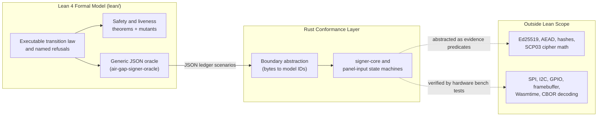
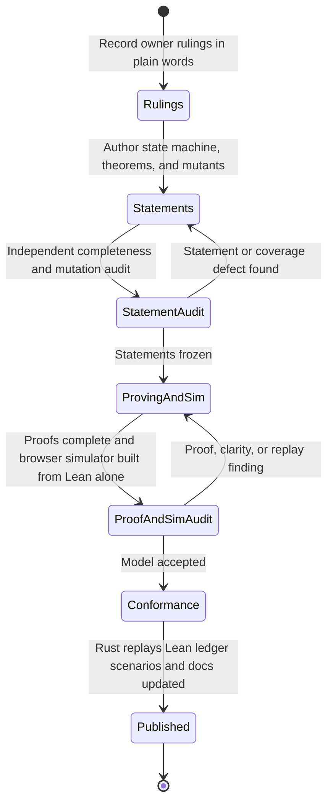

# Lean Formalization Evaluation and Plan

## Who this is for

The owner who trusts this device with signing keys, and the developers building its firmware, core state machines, and tests. Before a transaction is signed or a wallet key is created, backed up, or erased, the signer enforces a chain of rules: every field must be shown or explicitly waived, a button pressed before the screen settled must not count, a backup must never drop its last recovery token, and in the target front-board architecture a stolen device with a captured PIN must still produce zero signatures without a fresh paired-phone approval.

!!! note "Status: evaluation, toolchain setup, and plan"
    This page records the formalization evaluation, the Lean 4 project setup under `lean/`, and the slice-by-slice formalization plan. No product invariants are proved yet; the Lean project currently builds its shared base types and generic JSON oracle driver scaffold.

## Why formalize this product

An air-gapped signer is unusually well suited to Lean 4 formalization because its security rests on small, deterministic, stateful guards rather than complex data structures:

- **Transaction review and waivers** decide when signing becomes possible (`crates/signer-core/src/review.rs`).
- **Signing sessions** govern mode switching, key filtering, signature staging, and invalidation (`crates/signer-core/src/session.rs`).
- **Multi-token recovery archives and disposable key lifecycles** govern seed wrapping, token enrolment/removal, and safe erasure (`crates/signer-core/src/backup.rs`, `crates/signer-pi/src/key_trial.rs`).
- **Physical input qualification** decides when switch contacts count as a fresh press or a PIN symbol (`crates/panel-input/src/lib.rs`, `crates/panel-input/src/token_pin.rs`, `crates/signer-pi/src/buttons.rs`).
- **Target signing authority** governs board enrollment, pre-PIN recognition, single-use second-factor approval, and separation of device identity from wallet keys (`hardware/front-board/secure-project.md`).

Inspection of the current Rust code while evaluating formalization scope already surfaced concrete state-machine gaps that prose reviews and unit tests missed:

1. **Nested waiver visibility loss in `review.rs`**: waiving a pending child entry pushes a waiver record and marks the child neither unseen nor unopened. If the user then waives an ancestor that still has another pending sibling, the ancestor's snapshot records the already-waived child as seen and opened. Unwaiving the ancestor clears `waived` on the child to `false` while leaving `unseen` and `unopened` as `false` and leaving the child's own waiver record intact. The unread child renders white as if actually read while remaining hidden from the remaining count.
2. **Eager hardware signing before session completion in `session.rs`**: pressing Confirm on a key in Sign mode calls the secure element immediately and caches the signature until Done. If the owner returns to Review and undoes a waiver, the cached signatures are dropped in memory, but the secure element has already signed. In the target phone-authorized architecture, a single-use approval must be consumed only when the committed signing action runs.
3. **Untrusted review-to-signing split in the prototype**: the Raspberry Pi and desktop flows still read `interpreter.wasm` and `sign.cbor` from the same untrusted USB stick without binding what was rendered to the exact bytes signed (tracked in issue `#10`, `#13`, `#14`).
4. **Two architectures in one repository**: the running code implements the Raspberry Pi and desktop prototype, whereas `hardware/front-board/secure-project.md` defines the production front-board controller (STM32H573 + SE051C2 + paired offline phone). Formalization must model each layer explicitly rather than conflating prototype behaviour with target guarantees.

## Formalization boundary

Lean proves properties of the abstract state machines and authorization laws. It does not try to prove cryptographic primitives, Wasmtime internals, CBOR parsers, or Linux/embedded peripheral drivers. Instead, every Lean slice exports an executable transition function and boundary observations through a single JSON oracle binary (`lean/AirGapSigner/Oracle.lean`), which Rust conformance tests replay against the real implementation.

| Domain | In Lean 4? | Reason |
|---|---|---|
| Review tree visibility, waivers, and completion gate | Yes | Pure state machine; already exhibits a subtle nested-waiver invariant bug |
| Signing session modes, key filtering, signature staging | Yes | Small transition system directly guarding secure-element signing calls |
| Multi-token backup and disposable key lifecycle | Yes | Clear authorization and liveness laws (never remove last token, never erase on drifted backup) |
| Physical input arming, debounce, chord rejection, eyes-free PIN | Yes | Discrete sampled/timed state machine with sharp safety invariants |
| Target enrollment, recognition, dual-factor approval, identity separation | Yes | Unimplemented production security protocol where design-phase proofs and simulation have the highest leverage |
| Ed25519, Blake2b, SHA-256, ChaCha20-Poly1305, SCP03 | No | Modeled as opaque types and sound verification/evidence predicates |
| Wasmtime execution, Cardano CBOR decoding, framebuffer pixels, GPIO/I2C drivers | No | Verified by Rust tests, fuzzing, and hardware bench acceptance scripts |

## How each formalization slice runs

Each slice follows an iterative design-and-verification loop so the owner can review behaviour directly without having to read Lean syntax:

Every accepted model slice delivers three artifacts together:

1. **Proved Lean modules** under `lean/AirGapSigner/` with zero `sorry`, zero `admit`, only standard axioms, and a mutation ledger proving each guard is constrained by at least one theorem.
2. **Oracle surface and machine-readable corpus** registered in `lean/AirGapSigner/Oracle.lean`, containing both reachable positive traces and single-atom mutant refusal scenarios.
3. **Rust conformance replay** that runs the exact ledger scenarios through both the Lean oracle and the Rust implementation, asserting equality of observable outcomes and refusals.

```mermaid
sequenceDiagram
    participant Corpus as Ledger Scenario (JSON)
    participant Oracle as Lean Oracle (air-gap-signer-oracle)
    participant Suite as Rust Conformance Test
    participant SUT as signer-core / panel-input

    Corpus->>Oracle: Send initial state and action sequence
    Oracle-->>Suite: Expected model state or named refusal
    Corpus->>Suite: Translate scenario through boundary mapping
    Suite->>SUT: Execute real Rust operations
    SUT-->>Suite: Concrete outcome or error
    Suite->>Suite: Abstract concrete outcome and compare with oracle
```

## Planned slices

The slices are ordered to combine immediate value on existing pure Rust crates with early design-phase verification of the unimplemented production protocol.

### Slice 1: Transaction review, waivers, and signing session

- **Scope**: `crates/signer-core/src/review.rs`, `crates/signer-core/src/session.rs`, and the request-to-review binding boundary (`#10`, `#14`).
- **Lean modules**: `lean/AirGapSigner/Review.lean`, `lean/AirGapSigner/ReviewGoals.lean`, `lean/AirGapSigner/Session.lean`, `lean/AirGapSigner/SessionGoals.lean`.
- **Core guarantees to state and prove**:
  - No signing approval is enabled while any entry is neither shown in full nor covered by an active waiver.
  - Waiving and unwaiving compose cleanly across nested branches: unwaiving an ancestor never marks an unread descendant as read or leaves an orphaned waiver record.
  - Entering a level or detail page never hides a previously unseen entry as seen unless its row actually appeared within the visible window or its final detail page was reached.
  - Signing is offered only for keys matching both the requested slot and the requested algorithm.
  - Undoing a waiver invalidates any staged signatures and blocks `Done` from returning signatures until review is complete again.
  - `Done` with zero active signatures emits no signatures.
- **Immediate code payoff**: resolves the nested-waiver visibility bug in `review.rs` under a proved invariant and pairs it with conformance tests.

### Slice 2: Multi-token backup and disposable key lifecycle

- **Scope**: `crates/signer-core/src/backup.rs`, `crates/signer-pi/src/key_trial.rs`, and backup/non-exportability policy (`#11`).
- **Lean modules**: `lean/AirGapSigner/Backup.lean`, `lean/AirGapSigner/BackupGoals.lean`, `lean/AirGapSigner/KeyLifecycle.lean`.
- **Core guarantees to state and prove**:
  - A valid backup always has at least one enrolled token; removing the last token is always refused.
  - Duplicate token credential enrollment is refused; adding a new token requires an already-enrolled token and an intact seed bound to the backup's public key.
  - A stranger token, a token producing the wrong secret, or a tampered public key / sealed payload cannot restore or add tokens, and failed operations leave the backup state unchanged.
  - Disposable key erasure is refused unless the saved archive, exported public key, and chip public key still match the verified identity.

### Slice 3: Physical input qualification and eyes-free PIN entry

- **Scope**: `crates/panel-input/src/lib.rs`, `crates/panel-input/src/token_pin.rs`, and `crates/signer-pi/src/buttons.rs` (`#21`).
- **Lean modules**: `lean/AirGapSigner/Input.lean`, `lean/AirGapSigner/InputGoals.lean`.
- **Core guarantees to state and prove**:
  - No switch held across entry or screen arming can emit a PIN symbol, keystroke, or confirmation until a full neutral release has been observed.
  - Overlapping contacts (chords) never emit a symbol or action.
  - Only directional controls repeat when held; Confirm, Select, Cancel, and Mode never repeat.
  - In `wait_fresh`, any switch edge timestamped at or before the armed boundary is discarded and cannot approve the newly shown screen.
  - Restarting or completing PIN entry clears the sequence buffer and resets length to zero; recovery keyboard selection respects UTF-8 byte bounds and minimum PIN length on Submit.

### Slice 4: Target signing authority protocol

- **Scope**: `hardware/front-board/secure-project.md`, `hardware/front-board/signer-recognition.md`, and issues `#10`, `#12`, `#32`, `#38`, `#39`.
- **Lean modules**: `lean/AirGapSigner/Authority.lean`, `lean/AirGapSigner/AuthorityGoals.lean`.
- **Core guarantees to state and prove**:
  - **Pre-PIN recognition**: an offline verifier accepts a signer only on a fresh single-use challenge signed by the enrolled board attestation key with an approved firmware measurement and valid policy version; replayed challenges, unknown boards, revoked firmware, or restored wallets on a second board never produce a positive recognition.
  - **Dual-factor signing**: neither local PIN + Confirm alone nor a paired phone/token response alone can authorize a signing call.
  - **Single-use request binding**: a phone approval is bound to `(board, operation, key_id, immutable_request_digest, session, challenge)` and consumed at most once; changing the request, key, or session, or encountering a display failure, cancel, or reset, invalidates pending approval.
  - **Host isolation**: untrusted host/USB input cannot supply trusted review text, read raw PIN inputs, or select arbitrary byte ranges to sign.
  - **Identity separation and wipe**: restoring a wallet seed onto replacement hardware never transfers the old board's attestation identity; factory wipe erases access to the old wallet before allowing new enrollment.
- **Design-phase leverage**: this slice runs through the interactive simulator and want-ledger authority joins *before* STM32H573 firmware or SE051C2 applet policies are written.

### Slice 5: Cross-machine composition, want ledger, and conformance ratchet

- **Scope**: Whole-product composition across Slices 1–4, interactive operator simulator, and CI conformance ratchet.
- **Deliverables**:
  - Composition theorems linking input qualification → review/session → authority protocol → key lifecycle (explicitly documenting any uncomposed boundary).
  - Maintained want ledger (guard fields joined against writers across authority levels) adjudicated by the owner.
  - Project constitution principle recording the exact translation from concrete bytes/observations to model identities and listing unobservable proof-only fields.
  - CI obligation ratchet preventing regression on mapped theorems and oracle replay coverage.

## Setup choices and rejected alternatives

| Chosen | Rejected | Why |
|---|---|---|
| Standalone Lake project at `lean/` using `pkgs.lean4` (`v4.28.0`) from the already-locked `nixpkgs` | Separate `nixpkgs-lean` input or global `elan` install outside Nix | The repository's existing `nixpkgs` lock already provides Lean `4.28.0` from cache; using it adds zero flake inputs and guarantees identical local and CI toolchains while keeping `lean/` compatible with `lean-lsp`. |
| Abstract executable state machines (`stepFn` with named `StepResult.refused` reasons) and one generic JSON oracle executable | Extracting Lean directly from Rust (Aeneas/Charon) or writing per-theorem Lean executables | Rust-to-Lean extraction couples proofs to low-level implementation details and cannot model the unimplemented STM32/phone protocol; a single generic oracle avoids per-theorem projection drift. |
| Start with pure state machines (`review`, `session`, `backup`, `panel-input`) alongside the target authority protocol | Formalize CBOR parsing, Wasmtime, or cryptographic primitives in Lean | High-risk failures in this product are state-transition and authorization bugs, not arithmetic inside audited crypto libraries. |
| Wire `just lean` (build, zero `sorry`/`admit` check, positive and negative oracle smoke checks) directly into `just ci` | Keep Lean as an optional manual command outside CI | Unchecked models drift immediately; `just ci` already drives hosted CI so adding `lean` keeps local and hosted gates identical. |

## Open questions for owner ruling

Before freezing theorem statements for Slice 1 and Slice 4, four concrete design questions need explicit rulings:

1. **Nested waiver semantics in `review.rs`**: when a user waives a child entry, then waives its parent branch, and later undoes the parent waiver, the current Rust code clears the child's `waived` flag while leaving it skipped by `remaining()`. Should waiving an ancestor supersede child waivers (so unwaiving the ancestor restores the child as pending), or should child waivers survive independently so unwaiving the ancestor leaves the child visibly waived (grey)?
2. **When the secure element actually signs in `session.rs`**: currently pressing Confirm on a key in Sign mode calls the secure element immediately and caches the signature in RAM, whereas `secure-project.md` requires consuming a single-use approval once for the committed operation. Should Sign mode stage key selections in memory and invoke the secure element only on `Done`, or keep immediate per-key signing for the prototype and restrict atomic commit to the target protocol?
3. **Slice execution order**: should we run **Slice 4 (target signing authority protocol)** first—so its proofs and interactive simulator settle the STM32H573 + SE051C2 + paired-phone protocol before firmware work starts—or run **Slice 1 (review and signing session)** first to fix the live nested-waiver bug and establish the Lean-to-Rust JSON oracle harness on working code?
4. **Possession factor scope in Slice 4**: `secure-project.md` describes both a paired offline phone (with pre-PIN recognition and QR approval) and an evaluated FIDO2 USB security token alternative (without a display). Should Slice 4 model the paired phone as the primary authority and treat the FIDO2 token as a separate parameterised variant with its weaker display-trust boundary explicitly recorded?
