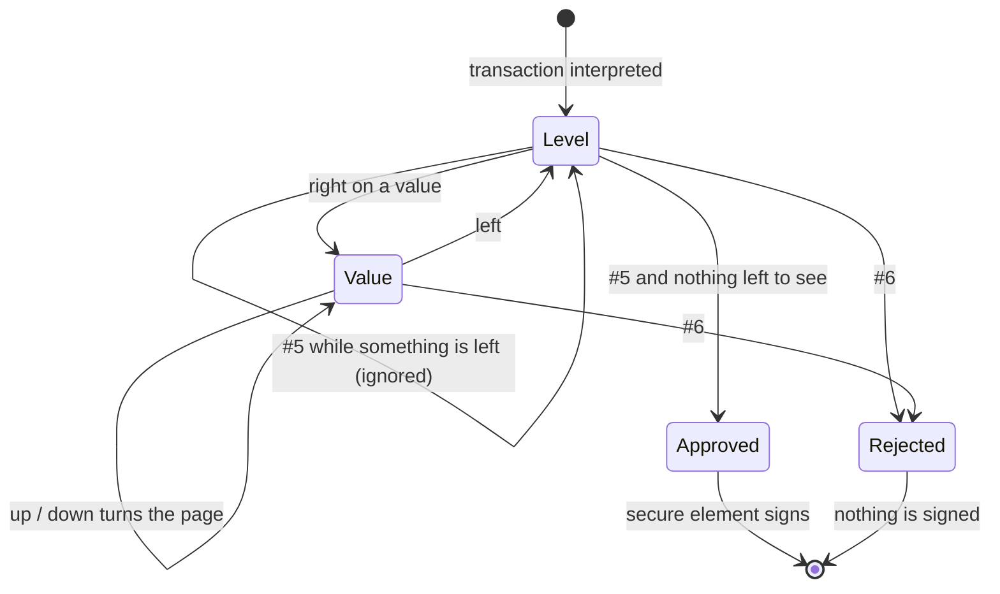
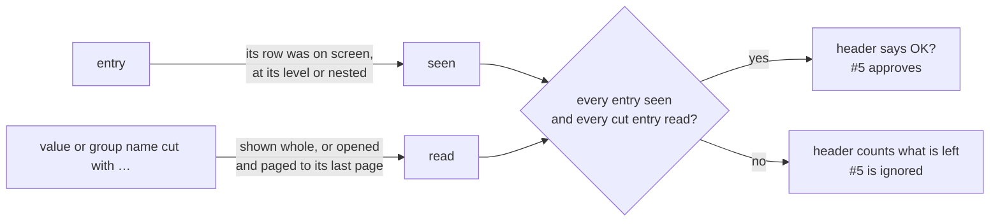

# Transaction Review

## Who this is for

The person holding the signer. A transaction has arrived on the USB
stick and the interpreter has turned it into fields; before anything is
signed, they read every field on a 240×240 screen and approve with
button #5 or refuse with #6.

!!! note "What runs today"
    The desktop simulator runs the whole flow: USB folder, interpreter,
    this review, signing. On the Raspberry Pi, `signer-pi-demo` runs this
    review on a built-in sample transaction and reports the decision;
    USB, interpreter and secure-element signing on the device are later
    phases. Binding what is shown to the exact bytes signed is tracked in
    [#10](https://github.com/paolino/air-gap-signer/issues/10).

The screen is small and a real transaction is not, so the review is a
tree browsed one level at a time, each level showing its groups' entries
indented under them. The rule that makes it safe: **#5 does
nothing until everything has been shown** — every entry of every group,
and every long value or group name read to its end. A transaction with
no fields at all is refused outright. A transaction cannot be approved
with a field still hidden in an unvisited branch or behind an ellipsis.

## What the user sees

```text
tx              7 left      tx›outputs›_0  3 left      …puts›_0›address 1/1
fee: 171485                 address: addr…tjqp          address:
network: preprod      →     lovelace: 5000000     →      addr_test1qz2fxv2um
outputs                                                  yhttkxyxp8x0dlpdt3k
  _0                                                     6cwng5pxj3jhsydzer3
  _1                                                    …
validity_e…: 87654321
```

- The **header** is the branch from the root to the level shown,
  `tx›outputs›_0`. Each step right adds a segment, each step left
  removes one. When it no longer fits, its start is cut so the deepest
  segments stay visible. On the right it counts what is still to see,
  and says `OK?` when nothing is left.
- Below it are the **entries** of that level, and under each group its
  own entries, indented. A group whose entries are listed under it is a
  plain heading (`outputs`). A nested group (`_0`) is drawn in **bold**:
  bold means right goes into it. Values are `key: value`. List items are
  numbered `_0`, `_1`, …
- **Colour** says what still blocks approval: a row is light red while
  it, or anything under it, has not been shown yet — an unread cut value,
  a group with fields not yet on screen — and white once it is done. The
  header is amber.
- The cursor stops on fields and on bold groups, never on a heading —
  unless the heading's name is cut and still has to be read.
- A value too long for its row is **cut in the middle** with `…`,
  keeping the key and both ends of the value. A group whose name does
  not fit is cut the same way.
- Opening a value shows the **key on its own rows and the value wrapped
  under it**, a page at a time; the header shows the page. Opening a
  group whose name was cut first shows its full name; right again goes
  into it.
- Every character outside printable ASCII is **spelled out** as
  `\u{hex}`, e.g. `東` as `\u{6771}`, and a backslash as `\\`.
  Characters the font cannot draw, control characters, look-alikes and
  literal escapes therefore never show as each other.
- Nothing shows as blank: an empty string is `""`, a string with spaces
  at either end is quoted (`" x"`), an empty object is `{}`.

## Controls

| Control | In a level | In a value |
|---|---|---|
| joystick up / down | move the cursor to the previous / next field or bold group, skipping headings; wraps around at both ends | previous / next page |
| joystick right | on a bold group: go into it; on a value or a cut name: show it in full; on a heading: nothing | from a group's full name: go into it |
| joystick left | back to the screen you came from, onto the row you left | back to the level |
| button #5 | approve, once nothing is left to see | — |
| button #6 | reject | reject |
| joystick press | — | — |

In the desktop simulator the arrow keys stand in for the joystick,
Enter for #5 and Esc for #6.

## States



## What counts as shown



An entry reaches the screen in its parent's level, or nested one level
under its group in the level above; deeper branches must be visited. Opening a long value without
paging to its end does not count.

## Buttons cannot answer a screen they did not see

Before each answer the device waits 100 ms for the panel to show the new
screen, then until every control is released, then one debounce period,
and throws away any press queued meanwhile. A press made before the
screen changed, or held across the change, cannot approve what replaced
it. Two narrower gaps remain — a press starting just before the queue
is cleared, and a panel transfer that silently fails — and are tracked
in [#21](https://github.com/paolino/air-gap-signer/issues/21).

## Decisions

| Chosen | Rejected | Why |
|---|---|---|
| Tree browsed one level per screen with entries nested under their groups, branch in the header | One flat list of every line; one level per screen with groups closed | A real transaction is too deep for a flat list on 11 rows. Closed groups said nothing about what is inside; nesting one level shows it, and drilling down keeps each screen readable while the header says where you are. |
| Cut long values in the middle, keep the key | Wrap every value in the list; cut at the end | Wrapping makes the list unreadable; cutting at the end hides the tail of an address, which is where address-poisoning attacks hide differences. |
| #5 locked until everything was shown | Let the user approve at any time | A field the user never saw cannot have been checked. |
| Joystick right and left to go in and out | Joystick press to open | Tried on the device: pressing the joystick in was awkward. |
| Groups in bold, no marker | A `›` before each group | Tried on the device: the marker was hard to read at this size. |
| Bold only for groups right can go into; headings plain | Bold for every group; counts like `{2}` after nested groups | Tried on the device: a bold heading that right cannot open is misleading, and counts added noise; the list keys `_0`, `_1` already say it is a list. |
| Light red for rows still to see, white when done, amber header | One colour for everything; a counter only; a cyan header | The counter says how much is left, the colour says where. Tried on the device: cyan read almost white on this panel, so the header lost its colour. |
| Spell out non-ASCII as `\u{hex}` | Draw it with the font | The font lacks most scripts; missing glyphs all look the same, so different values could look identical. |
| List items as `_0`, `_1` | `[0]`, `[1]` | Tried on the device: lighter to read. An object key literally named `_0` would look like a list item; transaction fields are not named that way. |
| Cursor skips headings | Cursor stops on every row | A heading is not a field and right does nothing on it. |
