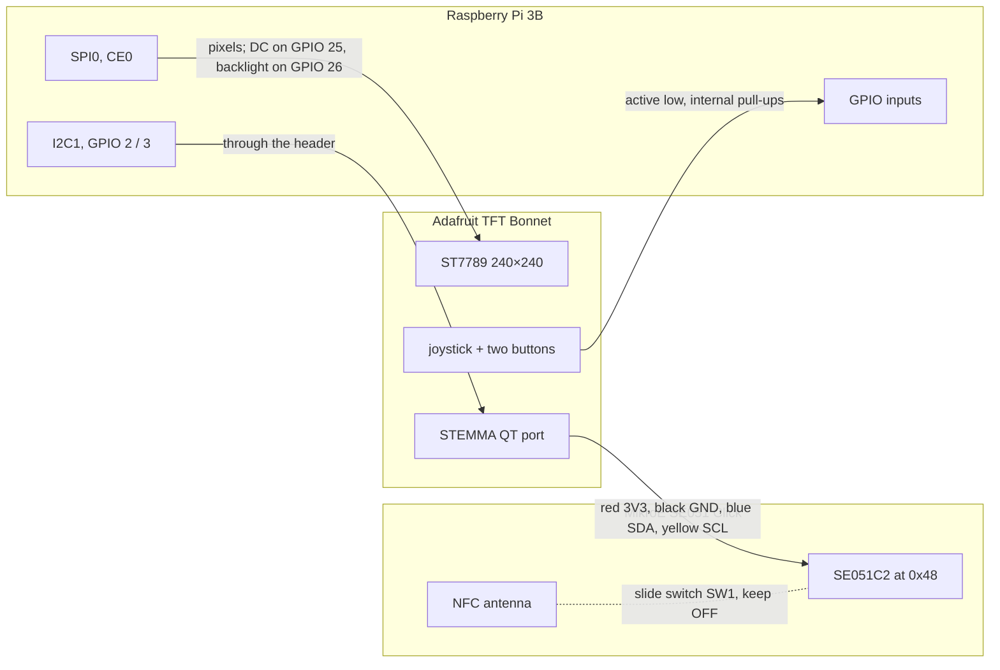
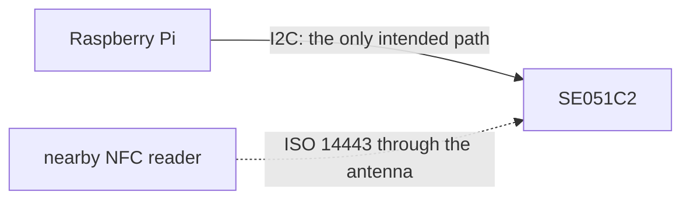

# Prototype Rig

## Who this is for

A developer who wants to run the signer on real hardware before the
production board exists. With this rig on the bench they can see the
secure element answer on I2C, draw on the screen and read every button —
the three things the Raspberry Pi HAL has to drive.

The rig is built from off-the-shelf boards. It is not the production
device: it differs from the target in the ways listed under
[Differences from the target](#differences-from-the-target).

## Parts

| Part | What it provides |
|---|---|
| Raspberry Pi 3 Model B V1.2 | 64-bit host (BCM2837), runs the same `aarch64` binaries as a Pi 4 or Zero 2W |
| [MikroE SE051 Plug&Trust Click](https://www.mikroe.com/se051-plugtrust-click) | NXP SE051C2 secure element on I2C, address `0x48` |
| [Adafruit 1.3" TFT Bonnet](https://www.adafruit.com/product/4506) | 240×240 ST7789 display on SPI, five-way joystick, two buttons, STEMMA QT I2C port |
| STEMMA QT to female jumper cable | carries 3V3, GND, SDA and SCL from the bonnet to the Click |
| microSD card | boot medium |

## Wiring

The bonnet sits on the Pi's 40-pin header and covers it. The secure
element does not need the header: the bonnet's STEMMA QT port carries the
Pi's I2C bus, and the jumper cable lands on the Click's mikroBUS pins.



The cable colours follow the STEMMA QT convention. On the Click, SDA and
SCL are on the lower mikroBUS row, 3V3 on the upper row; GND is on both.
Leave RST, EN and every NC pin unconnected.

## Controls

Every control pulls its line low when pressed. The pins were read from
the rig by watching edges while each control was pressed in turn; they
match Adafruit's published pinout.

| Control | GPIO |
|---|---|
| joystick up | 17 |
| joystick down | 22 |
| joystick left | 27 |
| joystick right | 23 |
| joystick press | 4 |
| button #5 | 5 |
| button #6 | 6 |

The lines need the internal pull-up enabled (`gpiod` bias `pull-up`).

## Display

The Raspberry Pi kernel ships an overlay for this panel. One line in
`config.txt` creates a 240×240, 16-bit RGB565 framebuffer:

```ini
dtoverlay=minipitft13,rotate=0
```

The driver takes GPIO 25 (data/command) and GPIO 26 (backlight); neither
collides with the controls. The framebuffer is `/dev/fb1`: writing
240×240 little-endian RGB565 pixels to it draws a frame.

## Bring-up check

On Raspberry Pi OS with I2C and SPI enabled
(`dtparam=i2c_arm=on`, `dtparam=spi=on`):

```console
$ /usr/sbin/i2cdetect -y 1
     0  1  2  3  4  5  6  7  8  9  a  b  c  d  e  f
...
40: -- -- -- -- -- -- -- -- 48 -- -- -- -- -- -- --
...
$ cat /sys/class/graphics/fb1/name
fb_st7789v
```

`48` is the secure element. If the grid is empty, check that SDA and SCL
are on the lower Click row and not on its NC pins.

The Pi 3B needs a 5.1 V / 2.5 A supply. `vcgencmd get_throttled` reports
under-voltage: bit 0 set means it is low now, bit 16 means it dipped since
boot.

## The contactless interface

The SE051C2 has an ISO 14443 contactless interface besides I2C, and the
Click wires it to an on-board antenna. A phone or reader held near the
board could then address the chip without passing through the Pi, which
contradicts the signer's rule that data enters only by USB stick.



What the sources establish:

- The Click has a slide switch, **ANTENNA (SW1)**: left is OFF, the
  default; right is ON
  ([product page](https://www.mikroe.com/se051-plugtrust-click)).
- In the
  [v100 schematic](https://cdn.sparkfun.com/assets/6/a/d/1/c/Schematic-21298-MIKROE_SE051_Plug_Trust_Click.PDF)
  SW1 breaks only the LA side of the coil; LB stays wired.
- NXP's public documents describe no setting that disables the
  contactless interface on the chip. The SE051 datasheet says a personalisation applet configures
  "communication parameter settings of I2C, ISO14443 and ISO7816
  interface"; its guide (AN13015) needs an NXP login and has not been
  read.
- The SE051A2 variant has no contactless interface at all
  ([AN12973](https://www.nxp.com/docs/en/application-note/AN12973.pdf)).
- Requiring platform SCP03 makes the applet refuse any command without the
  SCP keys, over either interface
  ([AN12413](https://www.nxp.com/docs/en/application-note/AN12413.pdf),
  §4.6.2). It does not turn the radio off.

| Option | Effect | Status |
|---|---|---|
| SW1 to OFF | opens the antenna loop | do this on the rig |
| remove SW1 or cut the LA-ANT trace | permanent open loop | candidate for a production build |
| SE051A2 instead of SE051C2 | no contactless interface in silicon | candidate for a production build |
| require platform SCP03 | commands over any interface need the SCP keys | belongs to the secure element driver work |
| leave as shipped | the chip answers a nearby reader | rejected |

## Differences from the target

| Aspect | Target in these docs | This rig |
|---|---|---|
| Board | Pi 4 or Zero 2W | Pi 3B |
| Secure element | SE050 on the custom breakout | SE051C2 on a MikroE Click, with NFC antenna |
| Display and buttons | unspecified | 1.3" ST7789 bonnet, joystick, two buttons |
| OS | Buildroot, read-only, no network | Raspberry Pi OS with Wi-Fi, for bring-up only |

The SE051 is driven through the same NXP Plug & Trust middleware and
IoT applet commands as the SE050, so the planned I2C driver is expected to
serve both. Which curves a given SE051 part supports depends
on its variant and should be checked against the part number before the
driver relies on Ed25519.
