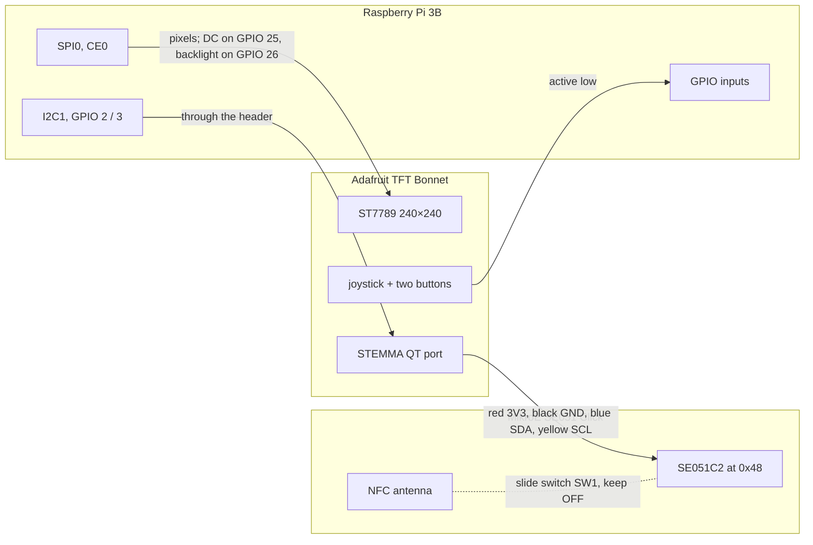
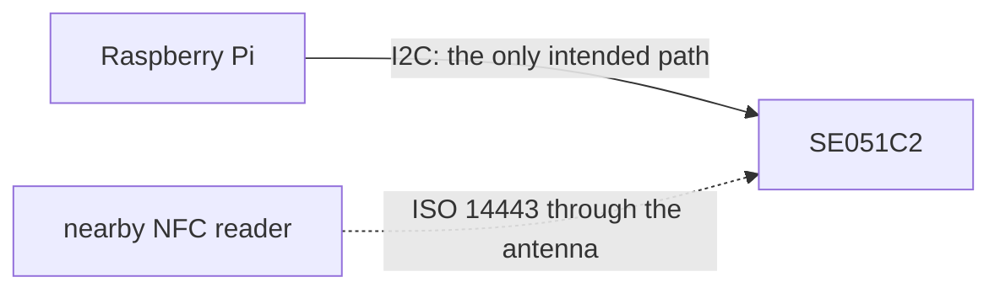

# Prototype Rig

## Who this is for

A developer who wants to bring up the signer's peripherals on real
hardware before the production board exists. With this rig on the bench
they can see the secure element respond on I2C, draw on the screen and
read every control — the three peripherals the Raspberry Pi HAL has to
drive. The HAL itself (`signer-pi`) is not written yet; everything below
is exercised from the Linux command line.

The rig is built from off-the-shelf boards. It is not the production
device: it differs from the target in the ways listed under
[Differences from the target](#differences-from-the-target).

## Parts

| Part | What it provides |
|---|---|
| Raspberry Pi 3 Model B V1.2 | 64-bit host (BCM2837); with a 64-bit OS it runs the same `aarch64` binaries as a Pi 4 or Zero 2W |
| [MikroE SE051 Plug&Trust Click](https://www.mikroe.com/se051-plugtrust-click) | NXP SE051C2 secure element on I2C, address `0x48` (NXP's default) |
| [Adafruit 1.3" TFT Bonnet](https://www.adafruit.com/product/4506) | 240×240 ST7789 display on SPI, five-way joystick, two buttons, STEMMA QT I2C port |
| [STEMMA QT to female jumper cable](https://www.adafruit.com/product/4397) | carries 3V3, GND, SDA and SCL from the bonnet to the Click |
| microSD card | boot medium |

Tested with Raspberry Pi OS Lite 64-bit (Debian 13 "trixie", image of
2026-10-06), kernel `6.18.50+rpt-rpi-v8`.

## Wiring

The bonnet sits on the Pi's 40-pin header and covers it. The secure
element does not need the header: the bonnet's STEMMA QT port carries the
Pi's I2C bus, and the jumper cable lands on the Click's mikroBUS pins.



| Cable wire | Click mikroBUS pin |
|---|---|
| blue | SDA, pin 11 |
| yellow | SCL, pin 12 |
| red | 3V3, pin 7 |
| black | GND, pin 8 or 9 |

The colours follow the STEMMA QT convention. Leave RST, EN and every NC
pin unconnected; with EN unwired, the Click's enable switch SW2 stays in
its default ON position.

## Controls

Every control pulls its line low when pressed. The pins were read from
the rig by watching edges while each control was pressed in turn; they
match [Adafruit's published pinout](https://learn.adafruit.com/adafruit-1-3-color-tft-bonnet-for-raspberry-pi/pinouts).

| Control | GPIO |
|---|---|
| joystick up | 17 |
| joystick down | 22 |
| joystick left | 27 |
| joystick right | 23 |
| joystick press (unused) | 4 |
| button #5 | 5 |
| button #6 | 6 |

Buttons #5 and #6 have 10 kΩ pull-ups on the bonnet; the joystick lines
need the Pi's internal pull-up (`gpiod` bias `pull-up`). Requesting it on
all seven is harmless. To watch the edges:

```console
$ gpiomon -c gpiochip0 -b pull-up -e falling --format "%o" 4 5 6 17 22 23 27
17
22
```

## Display

The Raspberry Pi kernel ships an overlay for this panel. Add one line to
`/boot/firmware/config.txt` and reboot:

```ini
dtoverlay=minipitft13,rotate=0
```

The driver takes GPIO 25 (data/command) and GPIO 26 (backlight); neither
collides with the controls. It registers a 240×240, 16-bit RGB565
framebuffer. Linux numbers framebuffers in registration order, so find it
by name rather than assuming an index:

```console
$ grep -l fb_st7789v /sys/class/graphics/fb*/name
/sys/class/graphics/fb1/name
```

On the tested image it is `/dev/fb1`. Writing 240×240 little-endian
RGB565 pixels to it draws a frame; three horizontal bands of red, green
and blue appeared in that order as the first visible check.

## Bring-up check

With I2C and SPI enabled (`dtparam=i2c_arm=on`, `dtparam=spi=on`):

```console
$ /usr/sbin/i2cdetect -y 1
     0  1  2  3  4  5  6  7  8  9  a  b  c  d  e  f
...
40: -- -- -- -- -- -- -- -- 48 -- -- -- -- -- -- --
...
```

A device acknowledging at `0x48` is consistent with the SE051 at its
default address; it does not identify the chip. NXP's Plug & Trust
middleware includes a `get info` example that reads the variant; the
signer's own driver will do the same. If the grid is empty, check
that the blue and yellow wires are on mikroBUS pins 11 and 12.

The Pi 3B needs a 5.1 V / 2.5 A supply. `vcgencmd get_throttled` reports
under-voltage: bit 0 set means it is low now, bit 16 means it dipped since
boot.

## The contactless interface

The SE051C2 has an ISO 14443 contactless interface besides I2C, and the
Click wires it to an on-board antenna. A phone or reader held near the
board could then address the chip without passing through the Pi, which
contradicts the signer's rule that data enters only by USB stick.



What the sources establish:

- The Click has a slide switch, **ANTENNA (SW1)**: left is OFF, which is
  the factory default; right is ON
  ([product page](https://www.mikroe.com/se051-plugtrust-click)).
- In the
  [schematic](https://download.mikroe.com/documents/add-on-boards/click/se051-plugtrust-click/SE051%20Plug%26Trust_click_v100b_Schematic.PDF)
  SW1 breaks only the LA side of the coil; LB stays wired.
- The [SE051 datasheet](https://www.nxp.com/docs/en/data-sheet/SE051.pdf)
  says the chip selects one interface at startup, checking for an RF
  field before I2C, and that the antenna pins of an unused contactless
  interface should be grounded. Whether a reader can reach the chip
  therefore depends on what is present at power-up, not only on the
  switch.
- NXP's public documents describe no setting that disables the
  contactless interface. The datasheet says a personalisation applet
  configures "communication parameter settings of I2C, ISO14443 and
  ISO7816 interface"; its guide (AN13015) needs an NXP login and has not
  been read.
- Requiring platform SCP03 makes the IoT applet refuse applet commands
  sent without the SCP keys
  ([AN12413](https://www.nxp.com/docs/en/application-note/AN12413.pdf),
  §4.6.2, written for the SE050; the SE051 equivalent, AN12543, needs an
  NXP login). NXP publishes the factory SCP keys
  ([AN12973](https://www.nxp.com/docs/en/application-note/AN12973.pdf)),
  so this protects nothing until they, and the recovery keys, are
  replaced with keys of our own. Whether the requirement holds for
  commands arriving over the contactless interface is not confirmed. It
  does not turn the radio off.
- [AN12973](https://www.nxp.com/docs/en/application-note/AN12973.pdf)
  lists the contactless interface and Ed25519 for the SE051C2 and
  SE051H2, not for the SE051A2. The A2 is therefore not a substitute: the
  signer needs Ed25519.

| Option | Effect | Status |
|---|---|---|
| SW1 left at OFF | opens the LA side of the antenna loop | bench precaution; keep it |
| ground LA and LB, remove the coil | follows NXP's guidance for an unused interface | candidate for a production build; confirm with a reader held over the chip while it powers up, since the chip only selects contactless at startup |
| require platform SCP03 with our own and recovery keys replaced | applet commands need those keys; contactless coverage unconfirmed | belongs to the secure element driver work |
| switch SW1 to ON | the chip can answer a nearby reader | rejected |

## Differences from the target

| Aspect | Target in these docs | This rig |
|---|---|---|
| Board | Pi 4 or Zero 2W | Pi 3B |
| Secure element | SE050 on the custom breakout ([Secure Element](../architecture/secure-element.md)) | SE051C2 on a MikroE Click, with NFC antenna |
| Display and buttons | unspecified | 1.3" ST7789 bonnet, joystick, two buttons |
| OS | Buildroot, read-only, no network | Raspberry Pi OS with Wi-Fi, for bring-up only |

The secure element driver is intended to serve both the SE050 and the
SE051. They share NXP's Plug & Trust middleware, but
[NXP's migration guide](https://www.nxp.com/docs/en/application-note/AN13014.pdf)
lists differences in I2C clock stretching, APDUs and object policies, so
the driver's PIN, key and signing operations must be tested on each part
and on each applet version it claims to support.
Which curves a given part supports depends on its variant; check the part
number before relying on Ed25519.

## Disposable key recovery trial

Run `signer-pi --practice-keys DIRECTORY` with the display, joystick, SE051 and
a FIDO2 recovery token attached to the Pi. Use a fresh private directory on
persistent storage. The trial uses SE051 test object `7DA03201`. The four
wallet slots are separate.

Enter the recovery token’s existing PIN on the panel. Move the joystick in four directions
to highlight a key on the QWERTY keyboard. Button #5 presses that key.
ABC changes case, #+= shows symbols, and Accents shows accented letters.
Holding any direction repeats movement. The selection flashes for 100 ms on
input. Space and Del edit the entry. Select the green Send key to submit, or press #6
to cancel. Only the character count is displayed. Keep the camera off during
entry. This PIN belongs to the FIDO token and is separate from the signer PIN.

The first run creates an encrypted `practice-backup.cbor` and exports the
32-byte public key in `practice-public.key`. The token performs the operation
that unlocks the backup. The panel rereads and decrypts the saved file and
checks that the chip can sign under the same public key before offering
to erase the test object. Check the fingerprint and back up both files to
another device. At an erase prompt #5 erases and #6 exits with the object
intact.

After erasure, restart the program using the two saved files and the same
token. It restores the test key, verifies a fresh signature, shows the
full public key and offers to erase the test object again. Both files
remain available. The file-backed credential uses the token’s
`hmac-secret` extension and PIN/UV protocol 2. Losing or resetting the
only enrolled token makes this trial backup unrecoverable. The phone
approval and chip policy required for actual wallet changes are separate
work.
